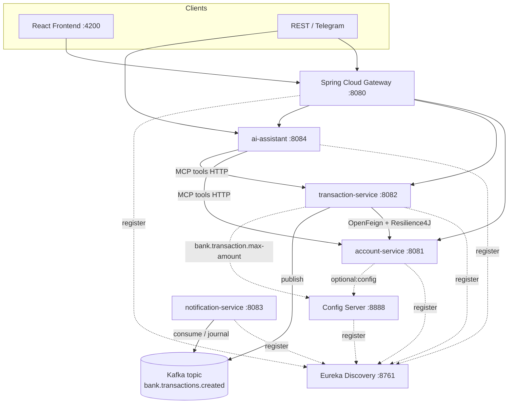
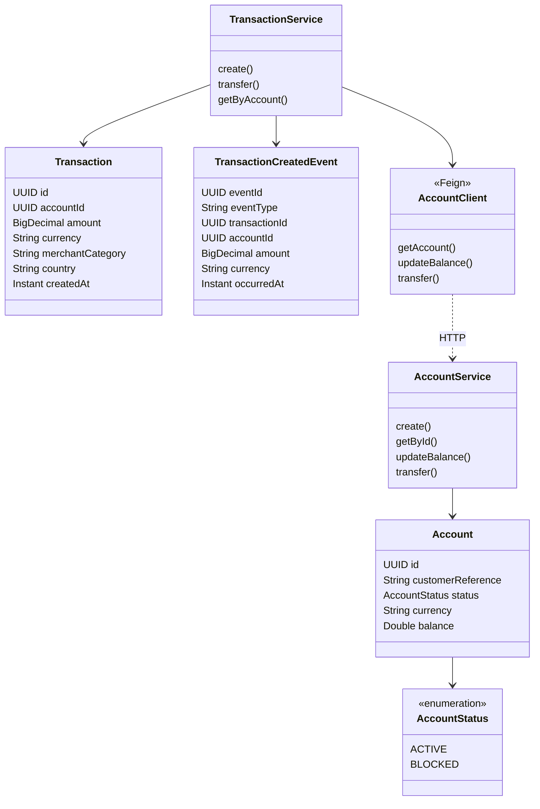

# Rapport technique — Test ADRIA ENSET

**Candidat :** ALOUANE Ayoub  
**Projet :** Plateforme bancaire microservices + IA + détection de fraude  
**Repository :** ALOUANE-Ayoub-Test-ADRIA-ENSET

---

## Partie B — Conception et Architecture

Voir `docs/architecture.md` (diagramme d'architecture Mermaid + diagramme de classes).

**Choix structurants :**
- Spring Boot 3.3 / Spring Cloud 2023.0
- Eureka + Config Server + Gateway
- OpenFeign + Resilience4J entre transaction-service et account-service
- Kafka pour `bank.transactions.created`
- MCP HTTP tools + agent AI (LLM optionnel / mode règles)
- React (Vite) pour le client web
- Python scikit-learn pour la fraude

---

## Partie C — Microservices fonctionnels

### Account-Service (`:8081`)
| Connecteur | Endpoint |
|---|---|
| REST | `POST/GET /api/accounts`, `POST /api/accounts/{id}/balance`, `POST /api/accounts/transfer` |
| GraphQL | `/graphql` (GraphiQL activé) |
| MCP | `GET /mcp/tools`, `POST /mcp/tools/{toolName}` |

Modèle : `id`, `customerReference`, `status (ACTIVE\|BLOCKED)`, `currency`, `balance`.

### Transaction-Service (`:8082`)
Règles métier implémentées :
1. Montant strictement positif et ≤ `bank.transaction.max-amount` (Config Server = 1000)
2. Compte existant et ACTIVE (via Feign)
3. Devise transaction = devise compte
4. Consultation solde puis débit après enregistrement
5. Virement `POST /api/transfers`

Tolérance aux pannes : Feign fallback factory + `@CircuitBreaker(name="accountService")`.

---

## Partie D — Microservices techniques

| Service | Port | Rôle |
|---|---|---|
| discovery-service | 8761 | Eureka |
| config-server | 8888 | Native config, partage `bank.transaction.max-amount=1000` |
| gateway-service | 8080 | Routage + CORS + CircuitBreaker fallback |

---

## Partie E — Chatbot agentique

Service `ai-assistant` (`:8084`) :
- Découvre les tools MCP des deux microservices
- Mode LLM si `OPENAI_API_KEY` est défini
- Mode règles offline sinon (`list accounts`, `transfer <uuid> <uuid> <amount>`, …)
- Client REST : `POST /api/chat`
- Client Telegram : `POST /api/chat/telegram` (+ `TELEGRAM_BOT_TOKEN`)

---

## Partie F — Kafka

Après persistance d'une transaction :
- Topic : `bank.transactions.created`
- Clé : `accountId`
- Consumer : `notification-service` journalise sans modifier les données

Format événement conforme au sujet (eventId, eventType=TransactionCreated, …).

---

## Partie G — Client web

React + Vite (`frontend/`) — console **AdriaLedger** :
- Comptes, transactions, virements, chat AI
- Appelle la Gateway `:8080`

---

## Partie H — Détection de fraude (Python)

Script : `fraud-detection/fraud_detection.py`  
Sorties : `fraud-detection/outputs/metrics.csv`, `evaluation.png`, `analysis_answers.txt`

Résultats typiques (split stratifié 80/20, seuil choisi sur train uniquement) :
- Classes : ~5.14 % fraudes (257/5000)
- Manquants : country, merchant_category, average_amount_last_7d
- Modèle retenu : régression logistique (meilleure AP en validation interne)
- Métriques fraude + matrice de confusion + average precision générées

Réponses aux 4 questions d'analyse : voir script / `analysis_answers.txt`.

---

## Partie I — DevOps

- `Dockerfile.service` multi-module + `frontend/Dockerfile`
- `docker-compose.yml` (Kafka, Eureka, Config, métier, AI, Gateway, frontend)
- `.github/workflows/ci-cd.yml` : compile → tests → build images → publish GHCR → deploy schématique
- Réponses courtes : `docs/devops-answers.md`

---

## Comment lancer (local rapide sans Docker infra)

```bash
# Terminal 1
mvn -pl discovery-service spring-boot:run
# Terminal 2
mvn -pl config-server spring-boot:run
# Terminal 3-7
mvn -pl account-service spring-boot:run
# KAFKA_ENABLED=false si Kafka absent :
KAFKA_ENABLED=false mvn -pl transaction-service spring-boot:run
mvn -pl ai-assistant spring-boot:run
mvn -pl gateway-service spring-boot:run
cd frontend && npm run dev
```

Ou : `docker compose up --build`

---

## Captures / tests à joindre

1. Eureka dashboard `http://localhost:8761`
2. Création compte + transaction via REST / UI
3. GraphiQL account & transaction
4. MCP `GET /mcp/tools`
5. Chat `POST /api/chat` → `{"message":"list accounts"}`
6. Logs notification-service (événement Kafka)
7. Sorties fraude `outputs/evaluation.png`


---

# Partie B — Conception et Architecture

## 1. Schéma d'architecture



## 2. Diagramme de classes (domaine métier)



## 3. Couches par microservice

```
account-service / transaction-service
├── domain/
├── repository/
├── service/
├── web/rest/
├── web/graphql/
└── mcp/
```

REST, GraphQL et MCP appellent **la même couche service**.


---

# Partie I — Réponses DevOps

## Secrets vs configuration

- **Configuration** : paramètres non sensibles (ports, URLs Eureka, `bank.transaction.max-amount`, feature flags). Versionnés dans Config Server / `application.yml`.
- **Secrets** : credentials (DB, OpenAI, Telegram, Keycloak). Jamais dans Git. Injectés via variables d'environnement, Docker secrets, ou un vault (HashiCorp / cloud secret manager). Distingués dans CI via `secrets.*` GitHub Actions.

## Contrôles de démarrage, disponibilité et vitalité

- **Liveness** (`/actuator/health/liveness`) : le process vit-il ? Sinon redémarrage du conteneur.
- **Readiness** (`/actuator/health/readiness`) : prêt à recevoir du trafic (DB/Kafka up) ? Sinon retiré du load balancer.
- **Startup** : sonde pendant le boot JVM (évite les kills prématurés).

## Logs, métriques et traces distribuées

- **Logs** : JSON structuré (correlation-id / traceId) vers stdout → agrégateur (ELK/Loki).
- **Métriques** : Micrometer → Prometheus/Grafana (latence, erreurs, circuit-breaker states).
- **Traces** : OpenTelemetry / Micrometer Tracing → Jaeger/Zipkin pour suivre une requête Gateway → Feign → Kafka.

## Stratégie de rollback

1. Images taguées par git SHA dans le registre.
2. En cas d'échec post-déploiement : `docker compose` / orchestrateur revient au SHA précédent.
3. Config Server : rollback du fichier de config (max-amount) sans rebuild.
4. Migrations DB backward-compatible (expand/contract) pour permettre un revert applicatif sans perte de données.
