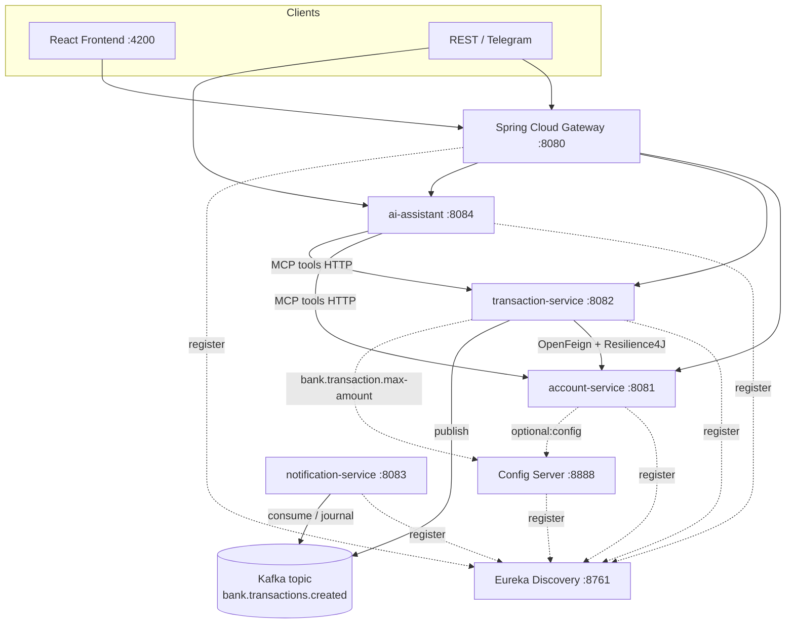
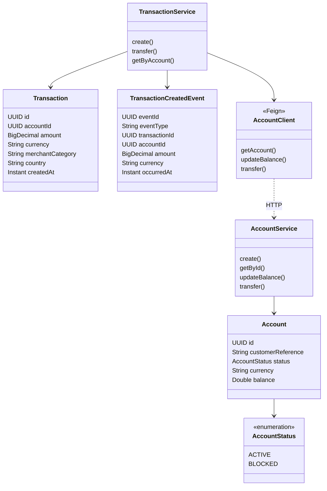

# Partie B — Conception et Architecture

## 1. Schéma d'architecture



## 2. Diagramme de classes (domaine métier)



## 3. Couches par microservice

```
account-service / transaction-service
├── domain/
├── repository/
├── service/
├── web/rest/
├── web/graphql/
└── mcp/
```

REST, GraphQL et MCP appellent **la même couche service**.
